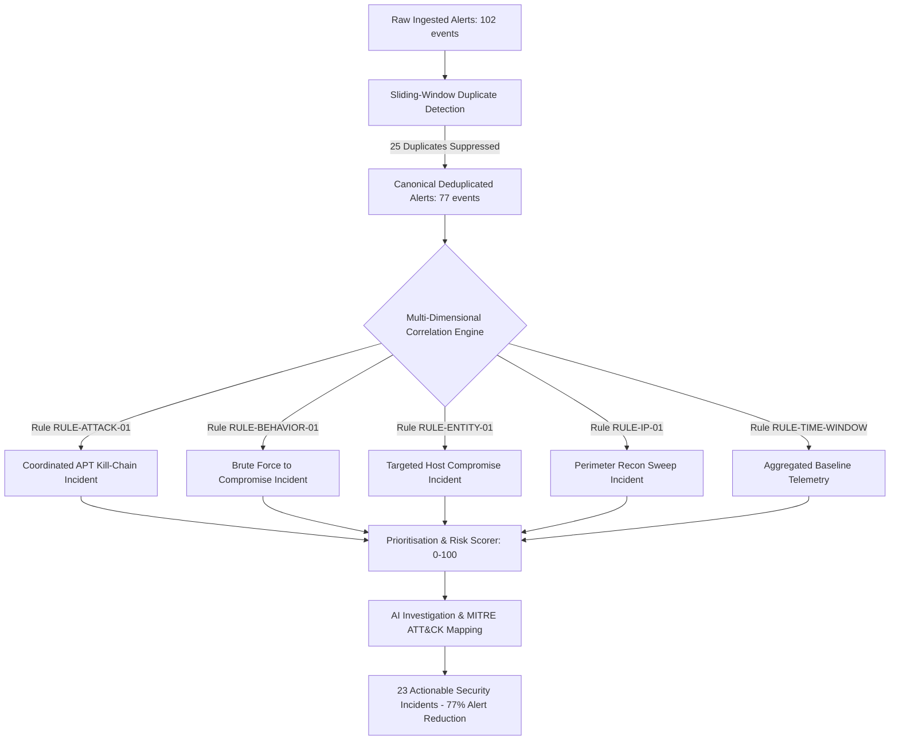

# 🛡️ AlertStormCorrelator
### Intelligent Security Alert Correlation and Prioritisation System

[](LICENSE)
[](https://www.typescriptlang.org/)
[](https://nodejs.org/)
[](https://react.dev/)
[](https://tailwindcss.com/)
[](https://socket.io/)

> **AlertStormCorrelator** is an enterprise-grade AI-powered Security Operations Center (SOC) alert correlation and prioritisation platform. It ingests thousands of noisy, repetitive alerts from multi-vendor security systems (Firewalls, EDRs, IDS, Active Directory, Cloud WAFs), normalizes them, suppresses duplicates via cryptographic sliding-window fingerprinting, groups related telemetry into cohesive security incidents across 7 distinct correlation dimensions, computes explainable 0–100 risk scores, and generates automated AI incident investigation dossiers aligned with the **MITRE ATT&CK** matrix.

---

## 📌 1. Problem Statement & Motivation

Modern organizations receive tens of thousands of security alerts daily from heterogeneous security sensors (Palo Alto NGFW, CrowdStrike Falcon, Suricata, Active Directory, AWS GuardDuty, Cloudflare WAF, Splunk).

Security analysts grapple with:
- **Alert Fatigue & Cognitive Overload:** Up to 80% of alerts are benign duplicates, minor noise, or isolated anomalies.
- **Fragmented Context:** Related steps of a coordinated kill-chain appear as separate alerts across distinct sensors.
- **Delayed Triage:** Critical multi-stage intrusions get buried beneath low-severity routine notifications.
- **Time-Consuming Manual Investigation:** Analysts spend hours cross-referencing IP logs, Kerberos events, and endpoint process trees.

**AlertStormCorrelator solves this** by transforming thousands of raw alerts into a small number of actionable, prioritized security incidents with full attack timelines and AI-assisted investigation recommendations.

---

## 🏛️ 2. System Architecture

```
[ Palo Alto NGFW ]  [ CrowdStrike EDR ]  [ Suricata IDS ]  [ Active Directory ]  [ Cloudflare WAF ]
        │                   │                   │                  │                    │
        └───────────────────┴─────────┬─────────┴──────────────────┴────────────────────┘
                                      │ Raw Syslog / JSON / CSV Telemetry
                                      ▼
             ┌──────────────────────────────────────────────────┐
             │            ALERT INGESTION GATEWAY               │
             │   - Multi-Vendor Schema Normalization            │
             │   - Input Validation (Zod Schemas)               │
             │   - Slotted Timestamp Standardization            │
             └────────────────────────┬─────────────────────────┘
                                      │ Canonical IAlert
                                      ▼
             ┌──────────────────────────────────────────────────┐
             │       DUPLICATE SUPPRESSION ENGINE               │
             │   - Cryptographic SHA-256 Fingerprinting         │
             │   - 15-Minute Sliding Window Deduplication       │
             └────────────────────────┬─────────────────────────┘
                                      │ Deduplicated Stream
                                      ▼
             ┌──────────────────────────────────────────────────┐
             │    INTELLIGENT CORRELATION ENGINE (7 DIMENSIONS) │
             │   1. Sliding Window Deduplication                │
             │   2. IP-Centric Pivot Analysis                   │
             │   3. Temporal Proximity Window (30-120m)         │
             │   4. Entity Convergence (User & Hostname)        │
             │   5. Attack Pattern / Multi-Stage Kill-Chain     │
             │   6. Behavioral Sequences (Failed -> Success)    │
             │   7. Multi-Source Cross-Sensor Verification      │
             └────────────────────────┬─────────────────────────┘
                                      │ Correlated Incident Clusters
                                      ▼
             ┌──────────────────────────────────────────────────┐
             │         RISK SCORING & PRIORITISATION            │
             │   - Base Telemetry Severity Weighting (0-35 pts) │
             │   - Alert Density & Velocity Burst (0-15 pts)    │
             │   - Kill-Chain Depth & Pattern (0-25 pts)        │
             │   - Asset Criticality (Crown Jewels) (0-15 pts)  │
             │   - Global Threat Intelligence Match (0-10 pts)  │
             │   ==> Composite Score: 0 - 100 (Crit/High/Med/Low)│
             └────────────────────────┬─────────────────────────┘
                                      │
                                      ▼
             ┌──────────────────────────────────────────────────┐
             │      EXPLAINABLE AI INVESTIGATION MODULE         │
             │   - MITRE ATT&CK Enterprise Matrix Alignment     │
             │   - Executive Summary Generation                 │
             │   - Chronological Attack Progression Timeline    │
             │   - Advisory Containment Action Proposals        │
             │   - Fact vs Hypothesis Boundary Preservation     │
             └────────────────────────┬─────────────────────────┘
                                      │
                   ┌──────────────────┴──────────────────┐
                   ▼                                     ▼
        ┌───────────────────────┐             ┌───────────────────────┐
        │   STORAGE LAYER       │             │ REAL-TIME STREAMING   │
        │ - MongoDB (Mongoose)  │             │ - Socket.IO Emitter   │
        │ - Resilient Embedded  │             │ - Live Monitoring Feed│
        │   JSON / RAM Engine   │             │ - Reactive Webhooks   │
        └───────────────────────┘             └───────────────────────┘
                   │                                     │
                   └──────────────────┬──────────────────┘
                                      ▼
             ┌──────────────────────────────────────────────────┐
             │      NEXT-GEN SOC ANALYST DASHBOARD (REACT)      │
             │  - Executive KPI Cards & Anomaly Trend Charts    │
             │  - Incident Management & Case Notes Workflow     │
             │  - 1-Click Interactive Hackathon Demo Loader     │
             └──────────────────────────────────────────────────┘
```

---

## ⚡ 3. Correlation Workflow & Methodology



### The 7 Implemented Correlation Techniques:
1. **Cryptographic Duplicate Suppression:** Alerts sharing identical signatures, source IP, destination IP, and category within a 15-minute sliding window are merged into master records, incrementing `duplicateCount` and suppressing redundant noise.
2. **IP-Centric Pivot Analysis:** Links disparate security events originating from or targeting identical external IP addresses across multiple perimeter sensors.
3. **Temporal Proximity Clustering:** Correlates anomalies occurring within configurable 30-, 60-, or 120-minute sliding inspection intervals.
4. **Entity Convergence:** Connects signals sharing common user credentials (`jsmith`, `svc_deploy`) or internal host assets (`DC01.corp.internal`, `SRV-SQL-BACKUP`, `WS-FINANCE-04`).
5. **Attack Pattern / Kill-Chain Correlation:** Detects sequential progression spanning MITRE tactics: *Reconnaissance → Initial Access → Privilege Escalation → Lateral Movement → Exfiltration*.
6. **Behavioral Sequence Anomaly:** Discovers behavioral anomalies, such as multiple failed authentication rejections immediately followed by a successful logon and privileged group alteration from an external IP.
7. **Cross-Sensor Verification:** Verifies threats corroborated by distinct detection layers (e.g., Perimeter Firewall drop + EDR process alert + Identity Provider Kerberos ticket).

---

## 🧮 4. Risk-Scoring Methodology

Every correlated incident is evaluated dynamically against a 100-point transparent risk formula:

$$\text{Risk Score} = \min(100, S_{\text{base}} + S_{\text{volume}} + S_{\text{pattern}} + S_{\text{asset}} + S_{\text{threat\_intel}})$$

| Dimension | Max Points | Evaluation Logic |
| :--- | :---: | :--- |
| **Base Telemetry Severity** | 35 pts | Evaluates highest severity among grouped alerts (Critical = 35, High = 25, Medium = 15, Low = 8). |
| **Alert Density & Burst Volume** | 15 pts | Frequency and density amplification ($\ge 15$ alerts = 15 pts, $\ge 6$ alerts = 10 pts, $\ge 2$ alerts = 5 pts). |
| **Attack Pattern & Kill-Chain Depth** | 25 pts | Coordinated kill-chain sequence = 25 pts, Data exfiltration = 22 pts, Ransomware staging = 20 pts, Privilege escalation = 18 pts, Brute force = 14 pts. |
| **Asset Criticality (Crown Jewels)** | 15 pts | Involves Domain Controllers (`DC01`), Production DBs (`SRV-SQL-BACKUP`), or Core Infrastructure = 15 pts; enterprise workstation = 8 pts. |
| **Threat Intelligence Reputation** | 10 pts | Direct match against known malicious C2 or Tor exit node threat feeds = 10 pts. |

### Priority Thresholds:
- 🔴 **Critical Priority (90 – 100):** Severe organizational threat; immediate Tier-3 SOC intervention required.
- 🟠 **High Priority (70 – 89):** Confirmed hostile activity; active persistence or lateral movement probable.
- 🟡 **Medium Priority (40 – 69):** Suspicious anomaly; contained to edge or isolated endpoint.
- 🔵 **Low Priority (0 – 39):** Informational or routine operational baseline telemetry.

---

## 🧪 5. Demonstration Dataset & Scenarios

The system ships with **102 realistic cybersecurity alerts** pre-structured into 10 real-world attack scenarios:

1. **Coordinated Multi-Stage Attack (APT29 Simulation):**
   - Stage 1: Port sweep detected by Suricata IDS from `198.51.100.42`
   - Stage 2: Log4j CVE-2021-44228 probe blocked by Cloudflare WAF
   - Stage 3: Kerberos pre-auth failure for service account `svc_deploy`
   - Stage 4: Anomalous successful Kerberos logon ticket granted from external IP
   - Stage 5: Privilege escalation via `SeAssignPrimaryTokenPrivilege` flagged by CrowdStrike EDR
   - Stage 6: Lateral movement via PsExec service creation to database server
   - Stage 7: 4.8 GB outbound encrypted exfiltration to remote C2 listener on port 443
2. **Brute Force & Credential Compromise:** 8 rapid failed logons from `185.220.101.5` followed by interactive success and addition to Domain Admins group.
3. **Ransomware Staging:** Malicious macro in Excel, Volume Shadow Copies deletion via `vssadmin.exe delete shadows /all /quiet`, and bulk encryption on file share.
4. **Perimeter Reconnaissance Sweep:** Systematic TCP probes targeting ports 22, 80, 443, 3389, 8443, 9200 from `194.26.29.112`.
5. **DNS Tunneling C2 Beaconing:** High-entropy base64 TXT lookups and periodic 30.0s Cobalt Strike heartbeat from workstation `WS-EXEC-LAPTOP`.
6. **Data Exfiltration:** Unauthorized AWS RDS snapshot export to external account and bulk PII extraction via API.
7. **Unusual Administrative Activity:** Security Event Log cleared (`wevtutil cl Security`, Event 1102) on Domain Controller.
8. **Inbound SYN Flood & DDoS:** High-rate TCP SYN flood (4,500 pkts/sec) dropped by firewall from `91.240.118.172`.
9. **Sliding-Window Duplicate Group:** 15 identical SSH probe events suppressed into a single correlated parent alert.
10. **Routine Baseline Telemetry:** 50 normal informational events (AV scans, DHCP renewals, VPN logins) proving discrimination between noise and true attacks.

---

## 🛠️ 6. Technology Stack

### Frontend
- **Framework:** React 18 + Vite + TypeScript
- **Styling:** Tailwind CSS + Glassmorphism Theme (Dark Charcoal & Cyber Cyan)
- **Visualizations:** Recharts (AreaChart, BarChart, PieChart)
- **Icons:** Lucide React
- **Animations:** Framer Motion
- **Networking:** Axios + Socket.IO Client

### Backend
- **Runtime:** Node.js (v24 LTS)
- **Framework:** Express.js + TypeScript
- **Validation:** Zod schemas
- **Real-Time:** Socket.IO Server
- **Authentication:** JWT (JSON Web Tokens) + BcryptJS password hashing
- **File Parsing:** Multer + csv-parser

### Database & Storage Architecture
- **Dual-Mode Persistence Architecture:**
  1. **MongoDB + Mongoose:** Fully indexed schemas for User, Alert, Incident, CorrelationRule, ThreatIndicator, InvestigationNote, AuditLog.
  2. **High-Performance Embedded Engine:** If local MongoDB is unavailable or unconfigured, the application automatically initializes an embedded JSON/RAM persistence engine with zero downtime and identical query semantics.

---

## 🚀 7. Installation & Quick Start

### Prerequisites
- Node.js (v18 or higher; recommended v20+ or v24)
- npm (v9 or higher)

### Step 1: Clone or Navigate to the Workspace
```bash
cd AlertStormCorrelator
```

### Step 2: Install Dependencies
```bash
# Install root, backend, and frontend dependencies
npm run install:all
```

### Step 3: Seed Database & Execute Correlation
```bash
npm run seed --prefix backend
```

### Step 4: Run Application
```bash
# Concurrently launches backend (port 5000) and frontend (port 3000)
npm run dev
```

Open your browser at: **`http://localhost:3000`**

---

## 🔑 8. Demo Credentials & 1-Click Access

The application features **1-Click Demo Login** directly on the login page:

| Role | Username / Email | Password | Permissions |
| :--- | :--- | :--- | :--- |
| **Administrator** | `admin@alertstorm.io` | `Admin@12345` | Full access: rule builder, system resets, threat intel editing, incident assignment. |
| **Security Analyst** | `analyst@alertstorm.io` | `Analyst@12345` | Operational access: triage, case notes, status updates, alert queries. |

---

## 📡 9. REST API Reference

### Authentication
- `POST /api/auth/login` — Authenticate and receive JWT token.
- `POST /api/auth/register` — Create new security analyst account.
- `POST /api/auth/demo-login` — 1-click instant login as Administrator or Analyst.
- `GET /api/auth/me` — Retrieve current authenticated user profile.

### Alerts
- `GET /api/alerts` — Query alerts (supports `severity`, `status`, `sourceSystem`, `search`, `page`, `limit`).
- `GET /api/alerts/:id` — Get detailed alert object.
- `POST /api/alerts` — Ingest single security event.
- `POST /api/alerts/upload` — Ingest batch JSON or CSV file.
- `POST /api/alerts/simulate` — Generate simulated security alerts.
- `DELETE /api/alerts/:id` — Delete an alert record.

### Correlation
- `POST /api/correlation/run` — Execute complete correlation engine on all alerts.
- `GET /api/correlation/results` — Get current correlation efficiency metrics and rules.
- `GET /api/correlation/rules` — List active correlation rules.
- `PATCH /api/correlation/rules/:ruleId` — Toggle or update correlation rule parameters.

### Incidents
- `GET /api/incidents` — Query incidents (supports `priority`, `status`, `category`, `search`, `page`, `limit`).
- `GET /api/incidents/:id` — Get incident investigation dossier, timeline, and notes.
- `GET /api/incidents/:id/alerts` — Get all raw alerts clustered under this incident.
- `PATCH /api/incidents/:id` — Update incident status (`New`, `Investigating`, `Contained`, `Resolved`, `False Positive`) or assign analyst.
- `POST /api/incidents/:id/notes` — Append timestamped analyst investigation note.

### Analytics & Reports
- `GET /api/analytics/overview` — High-level KPI counters and system health status.
- `GET /api/analytics/trends` — Time-series telemetry and incident surge buckets.
- `GET /api/analytics/distribution` — Breakdown by severity, source sensor, category, top IPs, and target hosts.
- `GET /api/analytics/export?type=incidents|alerts` — Stream formatted CSV export.

### Threat Intelligence & Demo
- `GET /api/threat-intelligence` — List threat indicators, reputations, threat scores, and actor campaigns.
- `POST /api/threat-intelligence` — Add custom threat indicator.
- `POST /api/demo/reset` — One-click reload of the 100+ alert hackathon demonstration dataset.
- `GET /api/demo/health` — Sensor connectivity, AI engine, and database health check.

---

## 🏆 10. Hackathon Demonstration Walkthrough

1. **Open Dashboard (`/`):**
   - Observe the top banner showing **77% Alert Fatigue Reduction** (102 raw alerts condensed into 23 actionable incidents).
   - Review the 6 KPI cards, chronological area charts, and top attacking IPs.
2. **Inspect Incidents (`/incidents`):**
   - Filter by `Critical` priority to immediately see the **Coordinated Multi-Stage Attack from 198.51.100.42**.
   - Click to open the deep-dive investigation.
3. **Deep-Dive AI Investigation (`/incidents/INC-2026-001`):**
   - Review the AI Executive Summary and MITRE ATT&CK Matrix alignment (T1595, T1190, T1078, T1068, T1021, T1048).
   - Click the **Attack Timeline** tab to see the 7-stage reconstructed kill-chain.
   - Click **Correlated Telemetry** to inspect every underlying raw alert.
   - Add an investigation note in the **Analyst Notes** tab and update status to `Contained`.
4. **Live Ingestion & Simulation (`/ingestion` and `/monitoring`):**
   - Navigate to `/ingestion` and download `alerts_sample_100.json` or `alerts_sample_100.csv`.
   - Go to `/monitoring` and click **"Brute Force Wave"** or **"APT Lateral Movement"** to watch live socket events stream across the terminal and update the correlation graph in real time.
5. **Export Reports (`/analytics`):**
   - Click **"Export CSV"** to download raw data, or **"Export PDF Report"** for an executive presentation briefing.

---

## 📄 License
This project is open-source under the [MIT License](LICENSE).
AlertStormCorrelator — Engineered for next-generation SOC threat intelligence.
